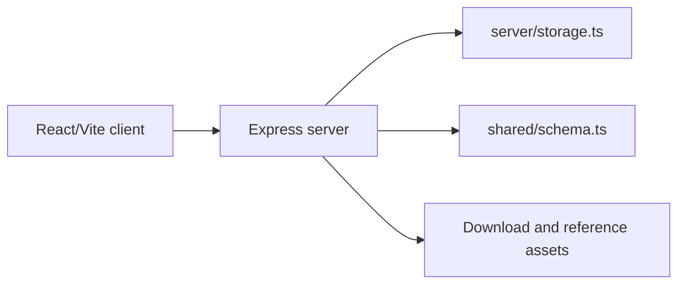

# ErgoTrack / Augmented Vision

## Project overview

Augmented Vision is a full-stack computer-vision prototype for collecting and presenting ergonomic movement analysis. The repository contains a Vite client, an Express/TypeScript server, shared schema definitions, and a large set of reference assets and research material for the ErgoTrack concept.

## Problem statement

Ergonomic assessment can be difficult to perform consistently from manual observation. This prototype explores a browser-based workflow for uploading or analyzing movement evidence and exposing results through a structured web application.

## Architecture



## Technology stack

- React and Vite for the browser application.
- TypeScript for client and server code.
- Express for HTTP routes in `server/`.
- Drizzle configuration and shared schema definitions for persistence.
- Tailwind/PostCSS tooling for styling.

## Project structure

- `client/` — browser entry point and UI assets.
- `server/index.ts` — server startup.
- `server/routes.ts` — application routes.
- `server/storage.ts` — persistence abstraction.
- `server/download-routes.ts` — download-related routes.
- `shared/schema.ts` — shared data definitions.
- `attached_assets/` — project evidence and reference material.

## Setup

```bash
npm install
npm run dev
```

Available package scripts also include `npm run build`, `npm run start`, `npm run check`, and `npm run db:push`. Review local environment configuration before enabling external services.

## Configuration and security

Use local environment variables for database connections and service credentials. The repository contains research assets; do not publish private documents or credentials from local development environments.

## Status

Research and prototype project. The README describes the current repository layout, not a production readiness claim.

## License

No license is currently declared.
